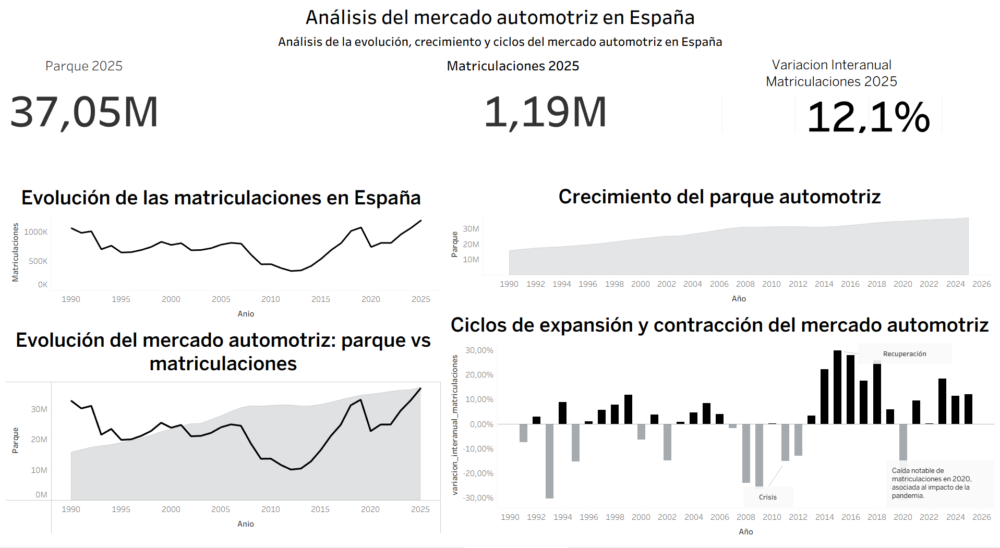

# 🚗 Automotive Market Analysis in Spain (1990–2025)

### 🇪🇸 Análisis del Mercado Automotriz en España

**Author:** Daniel  
**Project Type:** Data Analytics Portfolio Project  
**Tools Used:** Python, SQL (MySQL), Tableau, Pandas, Matplotlib  

---
## 📊 Interactive Dashboard / Dashboard interactivo
👉 [View Interactive Dashboard](https://public.tableau.com/app/profile/daniel.llad.garcia/viz/dashboardAutomotriz/AnlisisdelmercadoautomotrizenEspaa)
---

## Project Overview

This project analyzes the evolution of the Spanish automotive market from 1990 to 2025.  
The analysis focuses on vehicle registrations, vehicle fleet size, fuel type transition, environmental labels, and regional market distribution.

The project follows a complete data analytics workflow:
1. Data extraction
2. Data cleaning and transformation
3. Exploratory Data Analysis (EDA)
4. SQL business analysis
5. Data visualization (Tableau)
6. Business conclusions

The objective is to simulate a real-world automotive business analysis environment, similar to what a data analyst would perform in a car manufacturer, consulting firm, or financial institution.

---

## Business Questions

This project answers key business questions such as:

- How has the automotive market evolved over time?
- How fast is the vehicle fleet renewing?
- What is the market share by vehicle type?
- How has the fuel mix changed over time?
- Which provinces have the highest vehicle registrations?
- Which regions are adopting electric vehicles faster?
- Where is the vehicle fleet older?
- Is the fleet growing faster than registrations?
- Is the market becoming more electrified?
- How concentrated is the automotive market geographically?

---

## Project Structure
Automocion/
│
├── data/
│ ├── raw/ # Original data files
│ └── processed/ # Cleaned datasets
│
├── notebooks/
│ ├── 01_descarga_datos.ipynb
│ ├── 02_limpieza.ipynb
│ ├── 03_eda.ipynb
│ ├── 04_sql.ipynb
│ ├── 05_modelado.ipynb
│ └── 06_conclusiones.ipynb
│
├── sql/
│ ├── matriculaciones_insert.sql
│ ├── parque_insert.sql
│ ├── matriculaciones_provincia_insert.sql
│ ├── combustible_insert.sql
│ ├── distintivo_insert.sql
│ └── queries.sql
│
├── dashboards/ # Tableau dashboards
├── environment.yml
└── README.md

---

## Dataset Description

| Dataset | Description |
|--------|-------------|
| Registrations | Annual vehicle registrations |
| Vehicle Fleet | Total vehicles in circulation |
| Fuel Type | Gasoline, Diesel, Electric/Hybrid |
| Environmental Labels | CERO, ECO, C, B, No label |
| Registrations by Province | Regional distribution |

---

## Exploratory Data Analysis (EDA)

The EDA section includes:

- Evolution of vehicle registrations
- Evolution of the vehicle fleet
- Registrations by vehicle type
- Market share by vehicle type
- Fuel type evolution
- Fuel market share
- Environmental label distribution
- Top provinces by registrations
- Provinces with highest EV adoption
- Provinces with oldest vehicle fleet
- Fleet renewal ratio
- Registrations vs fleet comparison

These analyses help understand structural changes in the automotive market.

---

## SQL Analysis (Business Intelligence)

SQL was used to answer business-level questions and generate insights from the database.

### Key SQL Analyses Performed

| Analysis | Description |
|---------|-------------|
| Market growth | Year-over-year market growth |
| Fleet renewal ratio | % of fleet renewed per year |
| Market share by vehicle type | Turismos vs motorcycles vs trucks |
| Fuel transition | Gasoline vs diesel vs electric |
| Top provinces | Regions with highest sales |
| Provincial market share | Share of national market |
| Provincial growth | Fastest growing provinces |
| EV adoption | Provinces with most electric vehicles |
| Low-emission adoption | ECO + CERO penetration |
| Aging fleet | Vehicles without environmental label |
| Market concentration | Top provinces share |
| Fleet vs registrations growth | Structural market analysis |
| Fuel transition milestones | EV adoption thresholds |

This simulates real SQL analysis performed in automotive companies.

---

## 🧠 Key Insights

- The vehicle fleet shows sustained growth  
- Registrations are more volatile  
- Market renewal is not constant  
- The sector behaves cyclically  

## 🧠 Insights principales

- El parque automotriz crece de forma sostenida  
- Las matriculaciones son más volátiles  
- La renovación no es constante  
- El mercado es cíclico  

## Tools Used

| Tool | Purpose |
|------|---------|
| Python | Data cleaning and analysis |
| Pandas | Data manipulation |
| Matplotlib / Seaborn | Visualization |
| MySQL | Database and SQL analysis |
| Tableau | Dashboards |
| GitHub | Project portfolio |

---

## Dashboard (Tableau)

The Tableau dashboard includes:

- Market evolution
- Fleet vs registrations
- Fuel type transition
- Market share by vehicle type
- Geographic distribution
- Environmental labels distribution
- Aging fleet by province
## 📊 Dashboard Preview

## Conclusion

This project demonstrates a complete data analytics workflow applied to the automotive sector, combining Python, SQL, and data visualization tools to generate business insights.

The analysis shows structural changes in the Spanish automotive market, including fleet aging, fuel transition, regional differences, and market concentration.

This type of analysis is relevant for:
- Automotive manufacturers
- Consulting firms
- Financial institutions
- Insurance companies
- Government and policy makers

---

## 👤 Author

**Daniel Lladó García**  
Data Analyst | Python | SQL | Tableau  
📍 Madrid, Spain  