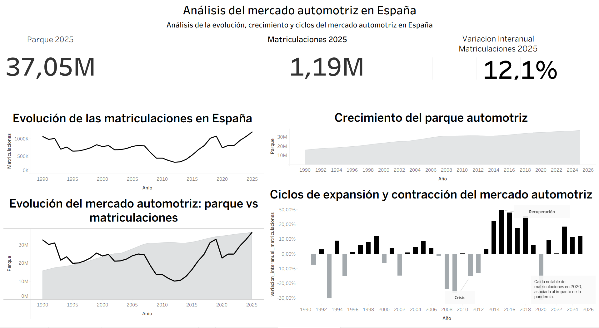

# 🚗 Automotive Intelligence Platform
### Análisis del Mercado Automotriz en España (1990–2025)

End-to-end data analytics project focused on analyzing the evolution and transformation of the Spanish automotive market through data engineering, statistical analysis and business intelligence.

**Author:** Daniel Lladó García  
**Location:** Madrid, Spain  
**Domain:** Automotive | Data Analytics | Data Engineering

---

## 📊 Interactive Dashboard

👉 [Explore the Tableau Dashboard](https://public.tableau.com/app/profile/daniel.llad.garcia/viz/dashboardAutomotriz/AnlisisdelmercadoautomotrizenEspaa)

---

## 🎯 Project Overview

Automotive Intelligence Platform analyzes the Spanish automotive market from 1990 to 2025, transforming historical data into meaningful business insights.

The project explores:

- Vehicle registrations and fleet evolution.
- Market share by vehicle category.
- Fuel type evolution and energy transition.
- Environmental labels.
- Geographic distribution by province.
- Market growth and fleet renewal indicators.

The objective is to build a modular, reproducible and scalable analytics solution inspired by real-world automotive industry use cases.

---

## 🏗️ Project Architecture

The project follows a modular Python architecture, separating data processing responsibilities into reusable components.

```text
Automocion/
│
├── data/
│   ├── raw/
│   └── processed/
│
├── notebooks/
│
├── src/
│   ├── utils.py
│   ├── extraction.py
│   ├── cleaning.py
│   ├── transformation.py
│   ├── features.py
│   └── database.py
│
├── tests/
│   ├── test_utils.py
│   ├── test_extraction.py
│   ├── test_cleaning.py
│   ├── test_transformation.py
│   └── test_features.py
│
├── sql/
├── dashboards/
├── environment.yml
└── README.md
```

---

## ⚙️ Data Engineering Workflow

The project is organized around the following stages:

1. Data extraction from original datasets.
2. Data cleaning and validation.
3. Data transformation and standardization.
4. Feature engineering.
5. Database integration.
6. Exploratory Data Analysis (EDA).
7. SQL business analysis.
8. Data visualization and reporting.

---

## 🧮 Feature Engineering

The `src/features.py` module contains eight reusable functions:

| Function | Purpose |
|---|---|
| `add_absolute_change()` | Absolute variation |
| `add_percentage_change()` | Percentage variation |
| `add_rolling_mean()` | Rolling averages |
| `add_cumulative_value()` | Cumulative calculations |
| `add_share()` | Relative contribution |
| `add_category_shares()` | Category participation |
| `add_time_features()` | Temporal features |
| `add_rank()` | Global and grouped rankings |

The module emphasizes input validation, missing value handling, data integrity, reusable code and preservation of original DataFrames.

### Automated Testing

The project uses `pytest` to validate functionality and edge cases.

**Latest validation:**

- 363 tests passed.
- 0 failures.
- 13.37 seconds execution time.
- 100% success rate.

---

## 📂 Data Sources and Analysis

The datasets cover several dimensions of the Spanish automotive market:

| Dataset | Description |
|---|---|
| Registrations | Annual vehicle registrations |
| Vehicle Fleet | Vehicles in circulation |
| Fuel Type | Registrations by fuel type |
| Other Categories | Additional vehicle classifications |
| Province | Geographic distribution |
| Environmental Labels | CERO, ECO, C, B and no label |

Data quality is a key consideration. The project includes validation of data types, missing values, duplicates and historical comparability. Methodological changes in source datasets are considered to avoid misleading comparisons.

---

## 📊 Business Intelligence & Visualization

The analytical work addresses business questions related to:

- Historical market growth.
- Vehicle category market shares.
- Fuel transition.
- Provincial rankings and market concentration.
- Environmental classification.
- Fleet renewal and aging.
- Registrations versus fleet evolution.

SQL is used for business-oriented analysis, while Tableau provides interactive visual exploration.

### Dashboard Preview



👉 [View Interactive Dashboard](https://public.tableau.com/app/profile/daniel.llad.garcia/viz/dashboardAutomotriz/AnlisisdelmercadoautomotrizenEspaa)

---

## 🛠️ Technology Stack

| Technology | Application |
|---|---|
| Python 3.11 | Data processing |
| Pandas & NumPy | Data manipulation |
| Matplotlib & Seaborn | Visualization |
| MySQL | SQL analysis |
| Tableau | Interactive dashboards |
| Pytest | Automated testing |
| Git & GitHub | Version control |
| Conda | Environment management |

---

## 🚧 Project Status

| Component | Status |
|---|---|
| Data extraction | Developed |
| Data cleaning | Developed |
| Data transformation | Developed |
| Feature engineering | Completed |
| Automated testing | 363 tests passed |
| EDA and SQL analysis | Existing analytical work |
| Tableau dashboard | Available |
| Database integration | Planned |
| Predictive modeling | Future development |

---

## 🔮 Future Development

- Database architecture and integration.
- Automated data loading and persistence.
- Advanced statistical analysis.
- Predictive modeling and machine learning.
- Automotive market segmentation.
- Further analysis of alternative powertrain adoption.

---

## 👤 Author

**Daniel Lladó García**  
Data Analyst | Engineering Background | Big Data & AI

Python · SQL · Data Analytics · Feature Engineering · Tableau

📍 Madrid, Spain

[GitHub](https://github.com/AnalistaDanielLlado) · [LinkedIn](https://www.linkedin.com/in/daniel-llad%C3%B3/)
